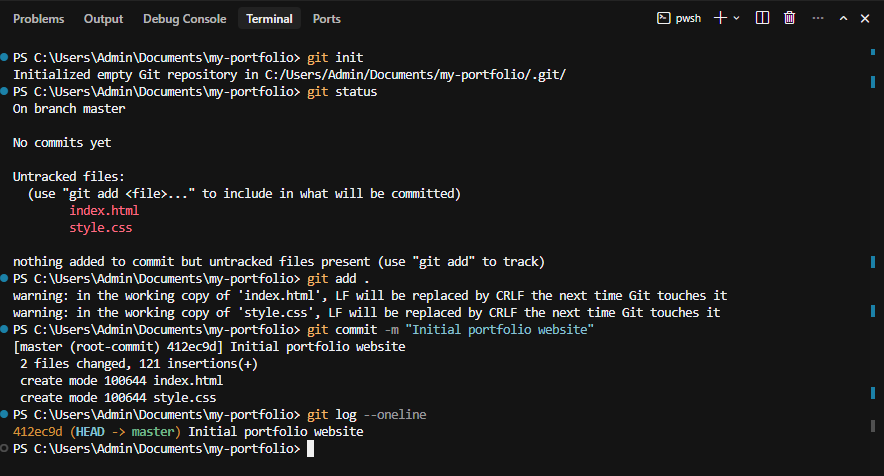
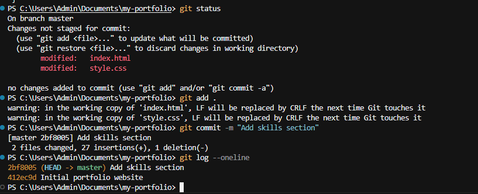
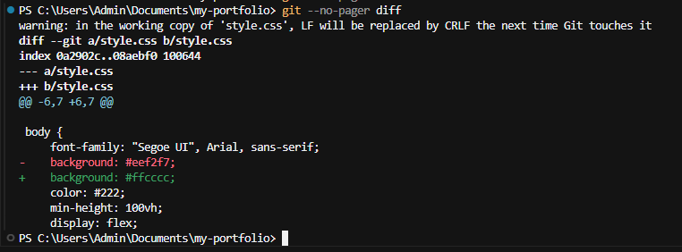
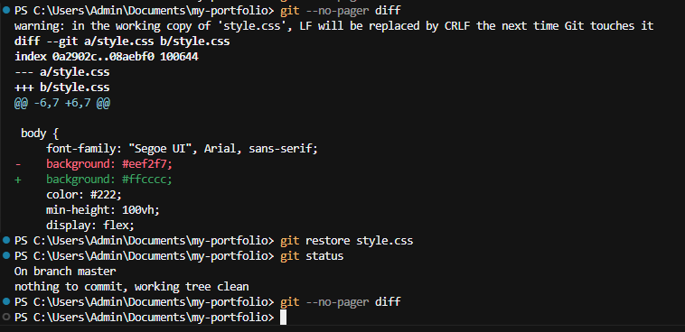
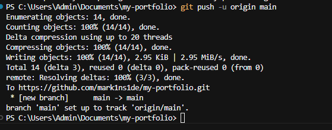
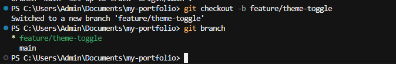
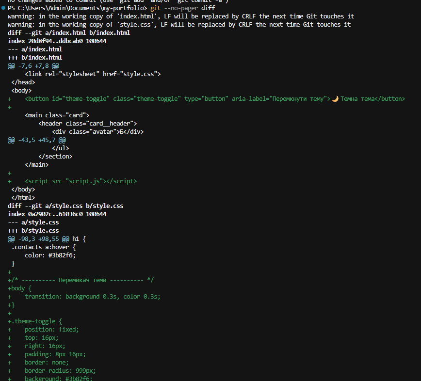
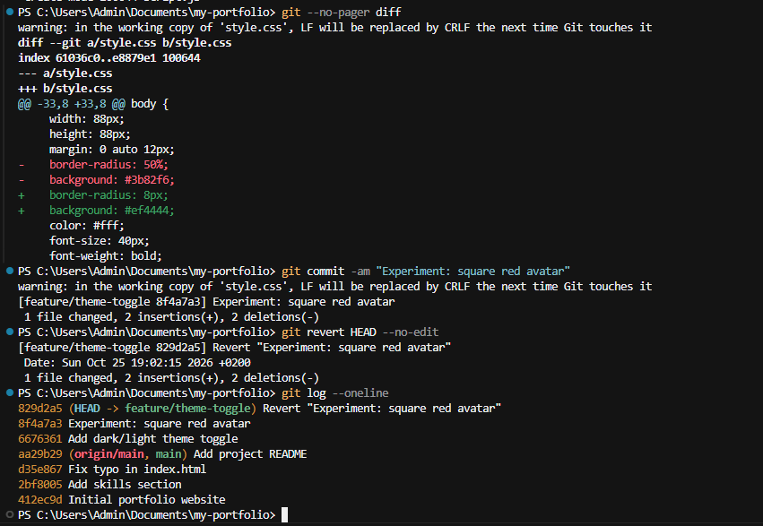
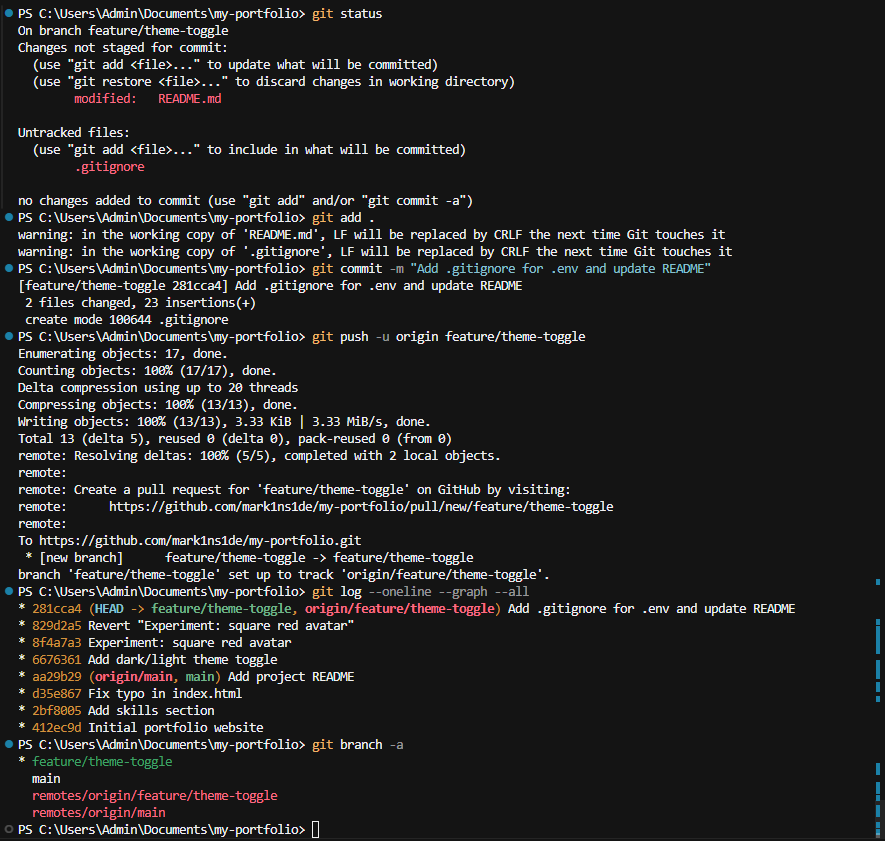

# Домашнє завдання — Модуль 5: Git і GitHub для безпечного вайб-кодингу

- **Студент:** Богдан ([@mark1ns1de](https://github.com/mark1ns1de))
- **Репозиторій:** https://github.com/mark1ns1de/my-portfolio
- **Сайт онлайн:** https://mark1ns1de.github.io/my-portfolio/
- **Pull Request:** https://github.com/mark1ns1de/my-portfolio/pull/1

## Короткий опис

За допомогою AI-агента я створив сайт-візитку з блоками «Про мене», «Мої навички» та «Контакти»,
а в окремій гілці `feature/theme-toggle` додав перемикач світлої та темної теми, який запам'ятовує вибір користувача.
Перед кожним комітом я переглядав зміни, внесені AI, через `git diff` і `git status`.
Для експерименту AI зробив аватар квадратним і червоним — цю зміну я скасував командою `git revert`,
не втративши перемикач теми та решту роботи; у першому завданні також відкотив незакомічену зміну фону через `git restore`.
Файл `.env` із вигаданим ключем додано до `.gitignore`, тож секрети не потрапили на GitHub —
Git дозволив мені безпечно експериментувати й будь-коли повернутися до робочої версії.

---

## Завдання 1. Мій перший репозиторій GitHub

| Крок | Що зроблено | Коміт |
|---|---|---|
| 1–3 | Створено `index.html` і `style.css`, `git init`, перший коміт | `412ec9d` Initial portfolio website |
| 4 | Додано блок «Мої навички», перевірено `git diff` | `2bf8005` Add skills section |
| — | Виправлено випадковий символ у HTML | `d35e867` Fix typo in index.html |
| 5 | Змінено фон без коміту → `git restore style.css` | — (зміну скасовано) |
| 6 | Створено README | `aa29b29` Add project README |
| 7 | Опубліковано на GitHub (`git push -u origin main`) | — |

**Ініціалізація та перший коміт**

**Другий коміт — блок навичок**

**Крок 5: `git diff` показує зміну кольору фону**

**Крок 5: `git restore` повертає файл до останнього коміту**

**Крок 7: публікація на GitHub**

---

## Завдання 2. Безпечне вдосконалення сайту за допомогою AI

| № | Вимога | Як виконано |
|---|---|---|
| 1 | Окрема гілка | `git checkout -b feature/theme-toggle` |
| 2 | Нова функція з AI | Перемикач світлої/темної теми (`script.js`, стилі `body.dark`) — `6676361` |
| 3 | Перегляд змін AI | `git status`, `git diff` перед комітом |
| 4 | Експеримент і його скасування | AI зробив аватар квадратним і червоним (`8f4a7a3`) → `git revert HEAD` (`829d2a5`) |
| 5 | `.env` + `.gitignore` | `.env` з вигаданим `DEMO_API_KEY`, у `.gitignore` — `.env` і `.env.*` |
| 6 | Фінальний коміт і push гілки | `281cca4`, `git push -u origin feature/theme-toggle` |
| 7 | README | Додано розділи «Нова функціональність» і «Безпека» |

Зміни з гілки влито в `main` через [Pull Request #1](https://github.com/mark1ns1de/my-portfolio/pull/1), гілку `feature/theme-toggle` збережено.

**Створення гілки**

**Перегляд змін, які вніс AI (`git diff`)**

**Експериментальна зміна дизайну та її скасування через `git revert`**

**Історія комітів і дві гілки (локальні та на GitHub)**

